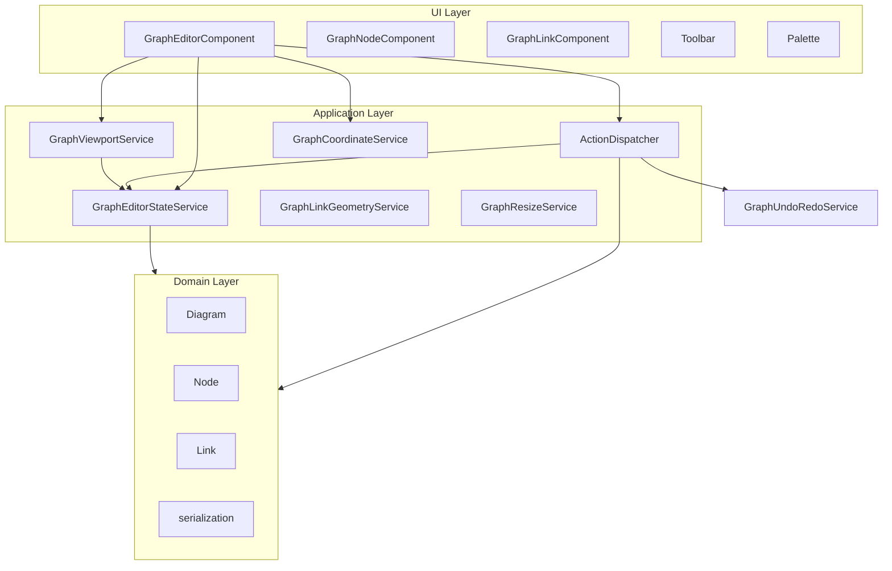

# Graph Canvas – Architecture

## Overview

Graph Canvas is a node-link diagram editor built with Angular 21. The codebase is structured in three layers: **domain**, **application**, and **UI**. The domain layer is framework-agnostic; the application layer holds state and commands (actions); the UI layer renders and delegates user input.

## Layer diagram



## Domain layer (`src/graph-core/`)

- **Diagram** — Container for nodes and links; single source of truth for the graph model. Removing a node also removes links connected to its ports.
- **Node** — Graph element with position, size, label, shape, rotation, and ports. Mutations (e.g. `setPosition`) are in-place.
- **GroupNode** — Subclass of Node that groups child nodes and links; stores children for ungroup and preview.
- **Link** — Connection between two ports; optional waypoints for polyline; routing: straight or orthogonal.
- **Port** — Connection point on a node; position is derived from node rect and side/offset.
- **Point** — 2D point with helpers for SVG and path segments.
- **Serialization** — `serializeDiagram`, `deserializeDiagram`, `cloneDiagramJsonForPaste` for save/load, undo snapshots, and paste.

The domain layer does **not** import from `@angular/*` or the app.

## Application layer (`src/app/features/graph-editor/`)

### State

- **GraphEditorStateService** — Holds all reactive state: `diagram`, `renderTick`, `viewBox`, `linkingFrom`, `linkingPreviewPoint`, `selectedNodeIds`, `selectedLinkIds`, `selectionRect`, `hasSelection`, `snapToGridEnabled`, `defaultLinkRouting`, `spaceKeyDown`, and id counters / clipboard. Single source of truth for UI binding.

### Actions (command pattern)

- **GraphEditorAction** — Interface: `pushUndoBeforeExecute: boolean`, `execute(ctx: ActionContext): void`.
- **ActionContext** — Passed to each action: `state`, `coordinate`, `linkGeometry`.
- **GraphEditorActionDispatcher** — Calls `undoRedo.pushState()` when the action requests it, then `action.execute(context)`. Used by the operations facade.
- **Node actions** — AddNode, AddNodeFromPalette, MoveNodes, RotateNodes, AlignNodes, GroupNodes, UngroupNode, ResizeGroupNode.
- **Link actions** — CreateLink, SetSelectedLinksRouting, AddLinkWaypoint, MoveLinkWaypoint, RemoveLinkWaypoint, MoveLinkSegment, ClearLinkWaypoints.
- **Clipboard actions** — Copy, Paste.
- **DeleteSelectionAction** — Deletes selected nodes and links (group confirmation is handled in the facade).

### Services

- **GraphOperationsService** — Thin facade: delegates to `GraphEditorActionDispatcher` and handles return values / pre-checks (e.g. group delete confirmation).
- **GraphUndoRedoService** — Undo/redo stacks of `DiagramJson` snapshots; restore replaces diagram and syncs counters via state.
- **GraphCoordinateService** — Client-to-SVG coordinate conversion and snap-to-grid.
- **GraphLinkGeometryService** — Path points, segment hit-test, orthogonal expansion, segment-to-waypoint index mapping.
- **GraphViewportService** — Pan, zoom at point, zoom to node/selection, fit to view.
- **GraphResizeService** — Resize handles for GroupNodes; tracks drag state and calls `GraphOperationsService.resizeGroupNode`.

## UI layer

- **GraphEditorComponent** — Main container: renders SVG (grid, links, nodes), handles pointer events (node/link drag, palette drop, pan, rubber-band, waypoints), exposes signals and methods for the template. Keyboard handling is delegated to the directive.
- **GraphEditorKeyboardDirective** — Document-level keydown/keyup: Space, Escape, Ctrl+A, Ctrl+C/V/Z/Y, Delete/Backspace (emits for component), KeyR (rotate), Ctrl+G / Ctrl+Shift+G (emits for group/ungroup). Attached to the graph-editor root div.
- **GraphNodeComponent**, **GraphGroupNodeComponent**, **GraphLinkComponent** — Present nodes and links; emit pointer events to the parent.
- **GraphToolbarComponent**, **GraphPaletteComponent** — Toolbar and shape palette; emit commands and drag start.

## Data flow (example: add node)

1. User clicks "Add node" in toolbar → toolbar emits `addNode`.
2. GraphEditorComponent handles `onAddNode()` → calls `operations.addNode()`.
3. GraphOperationsService.addNode() → `dispatcher.dispatch(new AddNodeAction())`.
4. GraphEditorActionDispatcher pushes undo (action has `pushUndoBeforeExecute: true`), then `AddNodeAction.execute(ctx)`.
5. Action reads `ctx.state.getDiagram()`, `ctx.state.viewBox()`, creates Node, adds to diagram, calls `ctx.state.setDiagram(d, true)`.
6. State updates; template re-renders via `diagram()` and `renderTick()`.

## Project structure (graph-editor feature)

```
graph-editor/
├── actions/           # Command/action layer
│   ├── action-context.ts
│   ├── action-dispatcher.service.ts
│   ├── graph-editor-action.ts
│   ├── node-actions.ts
│   ├── link-actions.ts
│   ├── clipboard-actions.ts
│   ├── delete-selection-action.ts
│   └── index.ts
├── directives/
│   ├── graph-editor-keyboard.directive.ts
│   └── index.ts
├── services/
│   ├── graph-editor-state.service.ts
│   ├── graph-undo-redo.service.ts
│   ├── graph-operations.service.ts
│   ├── graph-coordinate.service.ts
│   ├── graph-link-geometry.service.ts
│   ├── graph-viewport.service.ts
│   ├── graph-resize.service.ts
│   └── index.ts
├── graph-editor.component.ts
├── graph-node/
├── graph-group-node/
├── graph-link/
├── graph-palette/
└── graph-toolbar/
```

## Conventions

- **graph-core** must not import from `@angular/*`.
- Lifecycle: attach in `ngAfterViewInit`, detach in `ngOnDestroy`; unsubscribe from events and signals in `ngOnDestroy`.
- New undoable operations: add a new action class in the appropriate `actions/*.ts` file, then call `dispatcher.dispatch(new MyAction(...))` from `GraphOperationsService` (or from the component if it is a one-off).
