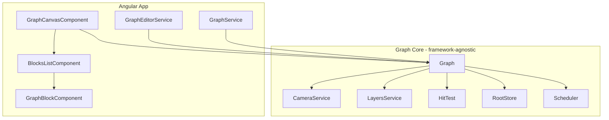

# Architecture: Graph Editor (Angular 21)

Target architecture after incremental port from @gravity-ui/graph.

## Overview

- **Core (framework-agnostic):** TypeScript classes with no `@angular/*` imports — Graph, Camera, Layers, HitTest, Store, Scheduler, Canvas components (Block, Connection). Reactivity via `@preact/signals-core` or Angular signals only at UI integration points.
- **Angular layer:** Services (create/destroy graph, facade API), GraphCanvas (container + attach/detach), BlocksList (visible blocks by viewport), GraphBlock (single block + optional custom content via template/directive).
- Architecture doc lives in the repo and is updated as layers are added.

## Diagram

## Core vs Angular

| Layer | Responsibility |
|-------|----------------|
| **Core** | Graph lifecycle, camera, layers, hit-test, store, scheduler, Canvas Block/Connection rendering. No Angular imports. |
| **Angular** | GraphService (create/get/destroy graph), GraphEditorService (facade API), GraphCanvasComponent (attach/detach, outputs), BlocksListComponent (visible blocks), GraphBlockComponent (block UI). |

## Lifecycle

1. Create Graph (core).
2. Attach to DOM container (GraphCanvasComponent: `ngAfterViewInit` → `graph.attach(container)`).
3. Start rendering (`graph.start()`).
4. Load data (`setEntities({ blocks, connections })`).
5. Cleanup: `graph.detach()` in `ngOnDestroy`.
